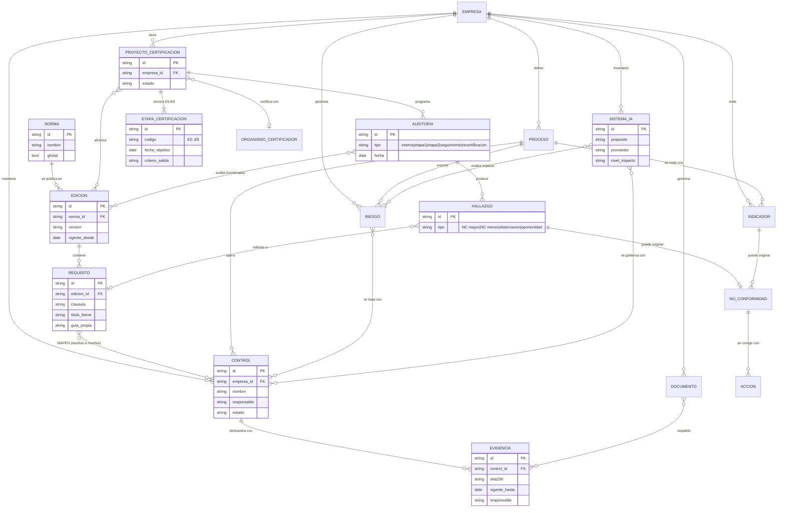

# Modelo de dominio inicial

Diagrama de entidades (Mermaid). Toda entidad de negocio lleva `empresa_id` (RLS), salvo las librerías globales de normas (Norma, Edición, Requisito), que son de solo lectura para las empresas. Las claves y atributos finales se definen en cada `/spec`.

## Reglas de dominio clave

1. **Un requisito común, una evidencia, varias normas:** la Evidencia cuelga del Control; el Mapeo conecta el Control con los Requisitos de cualquier Edición.
2. **Ciclo de 3 años (E8):** Seguimiento 1 ≤ 12 meses desde la decisión de certificación; Seguimiento 2; Recertificación antes del vencimiento.
3. **Etapa 2 exige** al menos una Auditoría interna y una Revisión por la dirección completadas.
4. **Declaración de Aplicabilidad** se deriva de Controles y Mapeos reales (27001 y 42001).
5. **Bitácora inmutable (P15):** transversal; toda creación, cambio, aprobación y eliminación se registra (quién, qué, cuándo, antes/después).
6. **Revisión por la dirección** y **Declaración de Aplicabilidad** son documentos generados; se modelarán en `/spec` de sus módulos.
