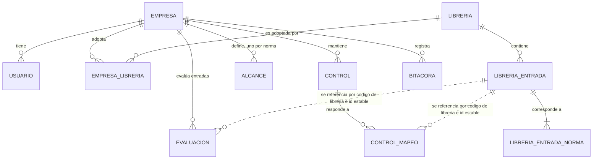

# Modelo de dominio inicial

Diagrama de entidades (Mermaid). Toda entidad de negocio lleva `empresa_id` (RLS), salvo las librerías globales de normas (Norma, Edición, Requisito), que son de solo lectura para las empresas. Las claves y atributos finales se definen en cada `/spec`.

> **Este diagrama es el norte, no lo construido.** El MVP de certificación (plan en `docs/specs/mvp-certificacion/plan.md`) implementa un subconjunto con algunas diferencias deliberadas; están en la sección «Lo construido en el MVP» más abajo, con las tablas reales.

```mermaid
erDiagram
    EMPRESA ||--o{ PROYECTO_CERTIFICACION : tiene
    EMPRESA ||--o{ PROCESO : define
    EMPRESA ||--o{ CONTROL : mantiene
    EMPRESA ||--o{ DOCUMENTO : gestiona
    EMPRESA ||--o{ RIESGO : gestiona
    EMPRESA ||--o{ SISTEMA_IA : inventaria
    EMPRESA ||--o{ INDICADOR : mide

    NORMA ||--o{ EDICION : "se publica en"
    EDICION ||--o{ REQUISITO : contiene
    REQUISITO }o--o{ CONTROL : "MAPEO (muchos a muchos)"
    CONTROL ||--o{ EVIDENCIA : "demuestra con"
    PROCESO ||--o{ CONTROL : opera
    PROCESO ||--o{ INDICADOR : "se mide con"
    PROCESO ||--o{ RIESGO : expone
    RIESGO }o--o{ CONTROL : "se trata con"
    DOCUMENTO }o--o{ EVIDENCIA : respalda

    PROYECTO_CERTIFICACION }o--o{ EDICION : "alcanza"
    PROYECTO_CERTIFICACION ||--|{ ETAPA_CERTIFICACION : "recorre E0-E8"
    PROYECTO_CERTIFICACION }o--o| ORGANISMO_CERTIFICADOR : "certifica con"
    PROYECTO_CERTIFICACION ||--o{ AUDITORIA : programa

    AUDITORIA }o--o{ EDICION : "audita (combinada)"
    AUDITORIA ||--o{ HALLAZGO : produce
    HALLAZGO }o--o| REQUISITO : "referido a"
    HALLAZGO ||--o| NO_CONFORMIDAD : "puede originar"
    NO_CONFORMIDAD ||--o{ ACCION : "se corrige con"
    INDICADOR ||--o{ NO_CONFORMIDAD : "puede originar"
    SISTEMA_IA }o--o{ CONTROL : "se gobierna con"
    SISTEMA_IA }o--o{ RIESGO : "evalúa impacto"

    %% --- v2 (spec modelo-dominio-v2). MVP: Alcance, Sede, Exclusión y la jerarquía de la librería. El resto, después. ---
    REQUISITO }o--o| REQUISITO : "tiene como padre"
    EMPRESA ||--o{ ALCANCE : define
    ALCANCE }o--|| EDICION : "de una norma y edición"
    ALCANCE ||--o{ SEDE : incluye
    ALCANCE ||--o{ EXCLUSION : justifica
    EXCLUSION }o--|| REQUISITO : excluye
    EMPRESA ||--o{ CERTIFICADO : obtiene
    CERTIFICADO }o--|| EDICION : certifica
    CERTIFICADO }o--o| CERTIFICADO : "reemplaza al del ciclo anterior"
    PROYECTO_CERTIFICACION ||--o{ CERTIFICADO : "termina en"
    EMPRESA ||--o{ ACTIVO_INFORMACION : inventaria
    PROCESO }o--o{ ACTIVO_INFORMACION : usa
    SISTEMA_IA ||--o{ EVALUACION_IMPACTO_IA : "se evalúa con"
    EMPRESA ||--o{ USUARIO : emplea
    USUARIO ||--o{ ASIGNACION_ROL : tiene
    USUARIO ||--o{ PERSONA_PROCESO : "se relaciona con"
    PROCESO ||--o{ PERSONA_PROCESO : "tiene personas"
    AUDITORIA }o--o{ PROCESO : audita

    NORMA {
        string id PK
        string nombre
        bool global
    }
    EDICION {
        string id PK
        string norma_id FK
        string version
        date vigente_desde
    }
    REQUISITO {
        string id PK
        string edicion_id FK
        string tipo "clausula|control|agrupador"
        string subtipo "tema|objetivo_control|capitulo (solo agrupador)"
        string padre_id FK "jerarquía de hasta 4 niveles"
        string identificador_en_norma "p. ej. 4.3 o A.5.1"
        string titulo_breve
        string guia_propia
    }
    CONTROL {
        string id PK
        string empresa_id FK
        string nombre
        string responsable
        string estado
    }
    EVIDENCIA {
        string id PK
        string control_id FK
        string sha256
        date vigente_hasta
        string responsable
    }
    PROYECTO_CERTIFICACION {
        string id PK
        string empresa_id FK
        string estado
    }
    ETAPA_CERTIFICACION {
        string id PK
        string codigo "E0..E8"
        date fecha_objetivo
        string criterio_salida
    }
    AUDITORIA {
        string id PK
        string tipo "interna|etapa1|etapa2|seguimiento|recertificacion"
        date fecha
    }
    HALLAZGO {
        string id PK
        string tipo "NC mayor|NC menor|observacion|oportunidad"
        string etapa_origen "etapa1|etapa2|seguimiento|recertificacion|interna"
        string estado "abierto|plan_propuesto|plan_aceptado|verificado|cerrado"
        date fecha_limite_cierre "la fija el organismo"
    }
    NO_CONFORMIDAD {
        string id PK
        string origen "auditoria_interna|auditoria_externa|indicador|queja|incidente|revision_direccion|riesgo|proveedor"
    }
    SISTEMA_IA {
        string id PK
        string proposito
        string proveedor
        string nivel_impacto
    }
    ALCANCE {
        string id PK
        string empresa_id FK
        string edicion_id FK
        string descripcion
        string interfaces_dependencias "27001 y 42001"
        string rol_organizacion "42001"
    }
    SEDE {
        string id PK
        string alcance_id FK
        string nombre
    }
    EXCLUSION {
        string id PK
        string alcance_id FK
        string requisito_id FK "solo clausulas que la norma permite no aplicar"
        string justificacion
    }
    CERTIFICADO {
        string id PK
        string empresa_id FK
        string edicion_id FK
        string numero
        date decision_certificacion
        date vence
        string estado "vigente|suspendido|alcance_reducido|vencido|retirado"
    }
    ACTIVO_INFORMACION {
        string id PK
        string empresa_id FK
        string nombre
        string responsable
        string clasificacion
    }
    EVALUACION_IMPACTO_IA {
        string id PK
        string sistema_ia_id FK
        date fecha
        string responsable
    }
    USUARIO {
        string id PK
        string empresa_id FK
    }
    ASIGNACION_ROL {
        string id PK
        string usuario_id FK
        string rol
        date desde
        date hasta "obligatoria para auditor externo"
    }
    PERSONA_PROCESO {
        string usuario_id FK
        string proceso_id FK
        string relacion "duena|participa|diseno|supervisa"
    }
```

## Lo construido en el MVP (hitos M1 a M3, 2026-11-11)

Tablas reales de PostgreSQL. Todo lo de la empresa lleva `empresa_id` con RLS forzada y claves foráneas compuestas `(empresa_id, id)`; el catálogo de librerías es global y de solo lectura para las empresas.

Las líneas punteadas no son claves foráneas: la entrada se referencia por `(código de librería, id estable)` y la evaluación fija además la versión de la librería usada (`libreria_id`), de modo que publicar una versión nueva de la librería no deja huérfana ninguna evaluación ni mapeo.

| En el norte | En el MVP | Diferencias y notas |
| --- | --- | --- |
| Norma, Edición, Requisito | `libreria`, `libreria_entrada`, `libreria_entrada_norma` | No hay tablas `norma` ni `edicion`: la entrada lleva su tipo (`clausula` o `control` del Anexo A), su tema (`grupo`) y, por cada norma a la que aplica, la edición y su numeración propia en `libreria_entrada_norma`. Sin jerarquía de padres. |
| Control | `control` | Medida **propia de la empresa**, con código único por empresa, estado `vigente` o `retirado` y versión. El responsable es un `responsable_id` (persona de la empresa). Aún no cuelga de un Proceso. |
| Mapeo | `control_mapeo` | Relaciona un control con **una entrada** (cláusula o control del Anexo A) de las librerías adoptadas. Máximo 50 por control. |
| *(no estaba)* **Evaluación** | `evaluacion` | Estado de cada entrada para la empresa: cumple, parcial, no cumple o no aplica; «sin evaluar» es la **ausencia de fila**. Lleva comentario, responsable, fecha objetivo y versión. |
| Proyecto de certificación (alcance) | `alcance` | El proyecto es **implícito** (uno por empresa). El alcance es un texto por norma con su aprobación (quién y cuándo); sedes y exclusiones en tablas quedan para después. |
| Evidencia | *(M4, pendiente)* | Con archivo, huella SHA-256, vigencia y reemplazo; una evidencia respaldará varias entradas. |
| Declaración de Aplicabilidad | *(M5, pendiente)* | Se derivará del diagnóstico y de los controles reales. |
| Bitácora inmutable | `bitacora`, `bitacora_ancla` | Encadenada por huellas; nada la modifica ni la borra. |
| Etapas, Auditoría, Hallazgo, No conformidad, Riesgo, Documento, Indicador, Sistema de IA, Proceso | *(fuera del MVP)* | Siguen siendo el norte. |

## Reglas de dominio clave

1. **Un requisito común, una evidencia, varias normas:** la Evidencia cuelga del Control; el Mapeo conecta el Control con los Requisitos de cualquier Edición.
2. **Ciclo de 3 años (E8):** Seguimiento 1 ≤ 12 meses desde la decisión de certificación; Seguimiento 2; Recertificación antes del vencimiento.
3. **Etapa 2 exige** al menos una Auditoría interna y una Revisión por la dirección completadas.
4. **Declaración de Aplicabilidad** se deriva de Controles y Mapeos reales (27001 y 42001).
5. **Bitácora inmutable (P15):** transversal; toda creación, cambio, aprobación y eliminación se registra (quién, qué, cuándo, antes/después).
6. **Revisión por la dirección** y **Declaración de Aplicabilidad** son documentos generados; se modelarán en `/spec` de sus módulos.
7. **Entradas de librería:** una entrada es de tipo cláusula, control o agrupador (tema, objetivo de control o capítulo), con un padre opcional. Es solo una referencia: identificador, título breve y guía propia, nunca el texto de la norma.
8. **Control de la norma frente a control de la empresa:** la Declaración de Aplicabilidad se arma por **control de la norma** (27001 y 42001); el **control de la empresa** puede ser adicional y no tener equivalente en el Anexo A.
9. **Independencia del auditor:** nadie audita un proceso con el que tiene relación (dueña, participa, diseñó, supervisa) ni uno que auditó recientemente; se evalúa por auditoría y por proceso.

**Reglas que ya cumple el MVP** (añadidas al construir M1 a M3):

10. **«Sin evaluar» no se guarda.** Una entrada sin fila está sin evaluar. Marcar «no aplica» exige una justificación de al menos 5 caracteres. Cambiar una evaluación es con **concurrencia optimista** por versión: si otra persona la cambió antes, el cambio se rechaza y no se pisa su trabajo.
11. **Madurez de la autoevaluación.** Cumple vale 100, parcial 50 y no cumple 0; «no aplica» queda fuera del cálculo y «sin evaluar» se cuenta aparte (no suma como cumplido). Sin nada evaluable el porcentaje es **nulo**, no 0. Se calcula por norma, por capítulo (cláusulas) y por tema (controles del Anexo A). Es una medida de la autoevaluación, **no** una probabilidad de certificarse.
12. **Un control no se borra, se retira.** Un control retirado no se cambia ni recibe mapeos, y su código no se reutiliza. Los mapeos sí se pueden quitar. Cada alta, cambio, retiro y baja queda en la bitácora.
13. **Aprobar el alcance** deja constancia de quién y cuándo; cambiar el texto de un alcance aprobado lo devuelve a «sin aprobar».
14. **Solo se trabaja con lo adoptado.** Evaluar, mapear o definir el alcance solo es posible sobre entradas y normas de las librerías que la empresa adoptó; lo demás responde como inexistente, igual que lo de otra empresa.
15. **La bitácora no guarda textos libres.** Ni el comentario de una evaluación, ni el texto del alcance, ni el nombre o la descripción de un control: solo estados, banderas y el objeto afectado.

## Marcas del MVP (spec `docs/specs/modelo-dominio-v2/spec.md`)

| Entrada | Marca |
| --- | --- |
| Jerarquía y tipos de la librería, identificador por norma, Anexo A | **MVP** |
| Alcance, Sede, Exclusión | **MVP** |
| Certificado, Activo de información, Evaluación de impacto de IA, origen de NC, estados y plazos de hallazgos | después |
| Asignación de rol con vigencia, Persona–proceso | después (antes de la primera auditoría interna) |
| Diagnóstico y Declaración de Aplicabilidad | se modelan en el spec del MVP |

> **El plan del MVP manda sobre estas marcas** (`docs/specs/mvp-certificacion/plan.md`, aprobado el 2026-11-10, es posterior y recorta el spec v2): en el MVP la jerarquía de librerías **no entra** (las entradas son planas, con tipo y tema), el alcance es **un texto por norma con su aprobación** y las sedes y exclusiones en tablas quedan para después. Lo que sí está construido está en «Lo construido en el MVP», arriba.
